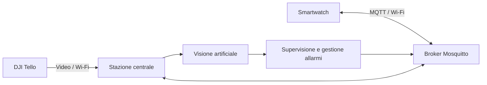

<p align="center">
  
</p>

# Work-Guardian

**Work-Guardian** è un **Cyber-Physical-Human System (CPHS)** per la sicurezza nei cantieri con lavorazioni in quota. Il sistema integra un **drone DJI Tello**, uno **smartwatch biometrico** e una **stazione centrale** per monitorare l'ambiente e l'operatore, rilevare situazioni di rischio e inviare segnalazioni in tempo reale.

Progetto sviluppato per il corso di **Cyber Physical Systems** dell'**Università degli Studi Roma Tre**, A.A. **2025/2026**.

## Funzionalità principali

- monitoraggio dell'area di lavoro tramite il flusso video del drone;
- riconoscimento di situazioni di rischio mediante modelli **YOLO**;
- acquisizione di **frequenza cardiaca** e **SpO₂** tramite smartwatch;
- comunicazione tra stazione centrale e wearable tramite **MQTT**;
- segnalazione degli allarmi al supervisore e all'operatore.

## Architettura



Il **drone** fornisce il flusso video alla stazione centrale, dove vengono eseguiti i modelli di visione artificiale. Lo **smartwatch** acquisisce i parametri biometrici dell'operatore e comunica con il PC attraverso il broker MQTT. La stazione centrale integra le informazioni e gestisce gli eventi di rischio e gli allarmi.

## Componenti

| Componente | Funzione |
|---|---|
| **DJI Tello** | Acquisizione video e monitoraggio dell'area di lavoro |
| **Computer vision** | Rilevamento di condizioni ed elementi rilevanti per la sicurezza |
| **Smartwatch biometrico** | Acquisizione dei parametri biometrici e ricezione degli allarmi |
| **Stazione centrale** | Elaborazione dei dati, supervisione e gestione degli eventi |
| **Mosquitto / MQTT** | Comunicazione tra PC e wearable |

## Struttura della repository

```text
work-guardian-cps-dicita/
├── communication/    # Configurazione di rete e broker MQTT
├── drone/            # Applicazione principale e gestione del drone
├── vision/           # Modelli YOLO e strumenti per training e test
├── wearable/         # Firmware e risorse dello smartwatch
├── requirements.txt  # Dipendenze Python
└── README.md
```

La documentazione specifica delle singole componenti è contenuta nelle rispettive directory.

## Tecnologie

**Python** · **DJI Tello** · **OpenCV** · **Ultralytics YOLO** · **PyTorch** · **Arduino Nano ESP32** · **MAX30100** · **MQTT** · **Eclipse Mosquitto**

## Avvio rapido

Clonare la repository e installare le dipendenze Python:

```bash
git clone https://github.com/faiellaemanuele/work-guardian-cps-dicita.git
cd work-guardian-cps-dicita
pip install -r requirements.txt
```

Configurare quindi la rete e il broker MQTT seguendo la documentazione in [`communication/docs/communication_setup.md`](communication/docs/communication_setup.md), quindi avviare l'applicazione principale:

```bash
python drone/main.py
```

## Autori

- **Michele Arietta**
- **Aurora Camusi**
- **Antonio Di Sabatino**
- **Emanuele Faiella Lauricella**
- **Riccardo Magnanelli**
- **Federico Pace**
- **Eleonora Ramunno**

## Nota

Work-Guardian è un **prototipo accademico** sviluppato a fini didattici e sperimentali e non costituisce un sistema di sicurezza certificato.
