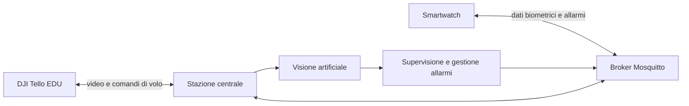

<p align="center">
  
</p>

# Work-Guardian

**Work-Guardian** è un Cyber-Physical-Human System (CPHS) per la sicurezza nei cantieri con lavorazioni in quota. Il sistema integra un drone DJI Tello EDU, uno smartwatch biometrico e una stazione centrale per monitorare l'ambiente e l'operatore, rilevare situazioni di rischio e inviare segnalazioni in tempo reale.

Progetto sviluppato per il corso di Cyber Physical Systems dell'Università degli Studi Roma Tre, A.A. 2025/2026.

## Funzionalità principali

- volo autonomo del drone lungo un percorso a waypoint, con localizzazione tramite marker AprilTag e filtro di Kalman;
- soste di supervisione nei punti previsti dal percorso, durante le quali modelli YOLO analizzano le immagini della camera;
- verifica dei dispositivi di protezione individuale dell'operatore: elmetto, occhiali, gilet e scarpe antinfortunistiche;
- verifica della presenza delle reti di sicurezza;
- rilevamento degli ingressi nelle aree interdette e delle cadute;
- misura di frequenza cardiaca e SpO₂ tramite smartwatch, con allarme in caso di valori anomali;
- segnalazione degli allarmi al supervisore sulla stazione centrale e all'operatore tramite display, LED e vibrazione dello smartwatch.

## Architettura



Il drone invia il flusso video alla stazione centrale, che ne calcola la posizione, lo guida lungo il percorso ed esegue i modelli di visione artificiale. Lo smartwatch misura i parametri biometrici dell'operatore e scambia messaggi con la stazione centrale attraverso il broker. La stazione centrale integra le informazioni e gestisce gli eventi di rischio e gli allarmi.

## Componenti

| Componente | Funzione |
|---|---|
| **DJI Tello EDU** | Volo lungo il percorso e acquisizione delle immagini dell'area di lavoro |
| **Smartwatch biometrico** | Arduino Nano ESP32 con sensore MAX30100: misura dei parametri biometrici e segnalazione degli allarmi all'operatore |
| **Stazione centrale** | PC che guida il drone, esegue i modelli di visione artificiale e gestisce gli allarmi |
| **Mosquitto / MQTT** | Comunicazione tra stazione centrale e smartwatch |

## Struttura della repository

```text
work-guardian-cps-dicita/
├── communication/    # Configurazione di rete e broker MQTT
├── drone/            # Applicazione principale e gestione del drone
├── vision/           # Modelli YOLO e strumenti per training e test
├── wearable/         # Firmware e risorse dello smartwatch
├── requirements.txt  # Dipendenze Python
└── README.md
```

La documentazione specifica dei singoli componenti è contenuta nelle rispettive cartelle.

## Avvio rapido

Per volare servono il drone DJI Tello EDU, che si collega alla stazione centrale tramite il proprio Wi-Fi, e un controller PS4. Lo smartwatch e il broker Mosquitto servono per il monitoraggio biometrico e per gli allarmi all'operatore.

Clonare la repository e installare le dipendenze Python:

```bash
git clone https://github.com/faiellaemanuele/work-guardian-cps-dicita.git
cd work-guardian-cps-dicita
pip install -r requirements.txt
```

Configurare la rete e il broker MQTT seguendo la documentazione in [`communication/docs/communication_setup.md`](communication/docs/communication_setup.md), poi avviare l'applicazione principale:

```bash
python drone/main.py
```

## Autori

- **Michele Arietta**
- **Aurora Camusi**
- **Antonio Di Sabatino**
- **Emanuele Faiella Lauricella**
- **Riccardo Magnanelli**
- **Federico Pace**
- **Eleonora Ramunno**

## Nota

Work-Guardian è un **prototipo accademico** sviluppato a fini didattici e sperimentali e non costituisce un sistema di sicurezza certificato.
